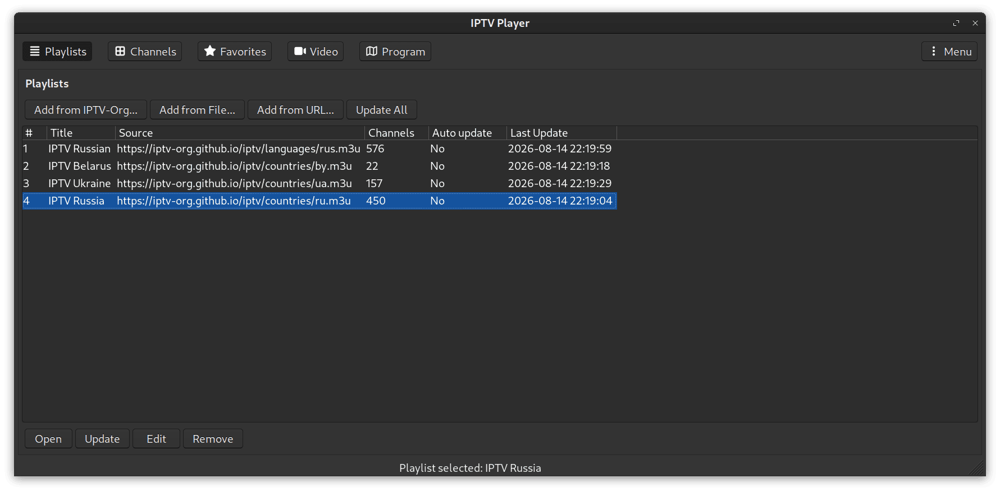
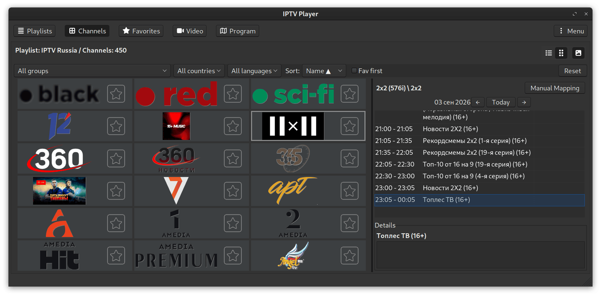
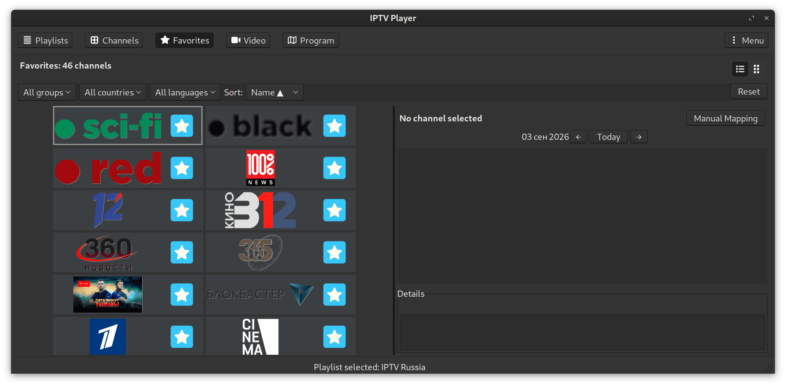
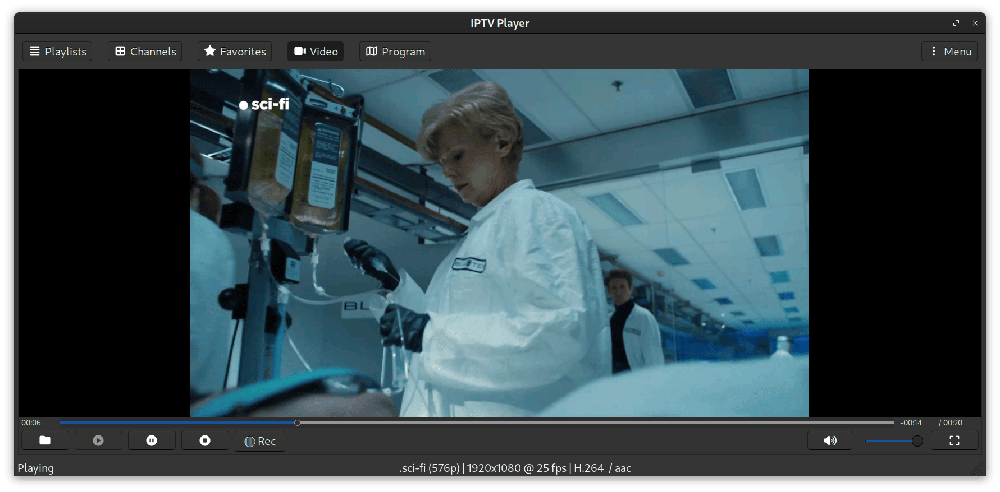
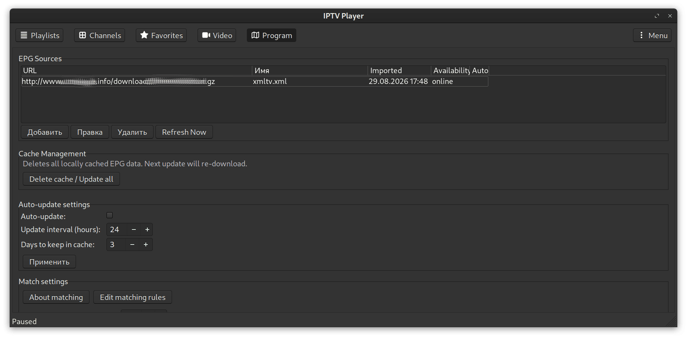

# IPTV Player

An IPTV player with M3U playlist support, favorites, channel logos, and an Electronic Program Guide (EPG).

---

## Screenshots

### Playlists

<a href="docs/screenshots/playlists.png"></a>

### Channels

<a href="docs/screenshots/channels.png"></a>

### Favorites

<a href="docs/screenshots/favorites.png"></a>

### Video Player

<a href="docs/screenshots/video.png"></a>

### EPG Program

<a href="docs/screenshots/program.png"></a>

---

## Detailed usage guide

The full user guide — playlists, channels, EPG, manual mapping, recording, IPTV-Org, export, keyboard shortcuts, data locations:

- **[Online (GitHub Pages)](https://i-jurij.github.io/iptvplayer/)**
- **[Source (docs/index.html)](docs/index.html)**
- **Offline:** bundled with the app — **Menu → About → Details**.

---

## Installation

### From GitHub Releases

Pick the artifact that matches your system:

| Artifact | Target |
| :--- | :--- |
| `iptvplayer-linux-<arch>-<version>-sharun.AppImage` | Any Linux, including old glibc, musl systems (Alpine, Void-musl), NixOS without FHS |
| `iptvplayer_<version>_<distro>_<deb-arch>.deb` | Ubuntu 24.04+, Debian 13+ |
| `iptvplayer-<version>-1.<distro>.<rpm-arch>.rpm` | Fedora, RHEL and RHEL-compatible distributions (Rocky Linux, AlmaLinux, CentOS Stream, Oracle Linux), ALT, ROSA, openSUSE Leap, OpenMandriva, Mageia. Built on Rocky Linux 9 (EL9); needs a distro at the same or newer EL level. |
| `iptvplayer-<version>-1-<distro>-<arch>.pkg.tar.zst` | Arch Linux, CachyOS, EndeavourOS (current glibc) |
| `iptvplayer-<version>-1-<distro>-<arch>-compat.pkg.tar.zst` | Manjaro, Garuda, UBLinux (glibc 2.42+) |

All artifacts come with `checksums.txt` and a detached GPG signature.
See [SECURITY.md](SECURITY.md) for verification instructions.

**Supported architectures.** The scripts recognise `x86_64`, `aarch64`, `i686`
and `armv7l`/`armv8l`/`armhf` (see `detect_arch` in `scripts/common.sh`).
Only `x86_64` is exercised in CI; everything else is best-effort.
linuxdeploy-AppImage is built only for `x86_64` and `aarch64` (upstream
limitation — see `populate_appdir` in `scripts/build-appimage.sh`).

### Update your system first

It is recommended to **update and upgrade your system before installing the
application**, so that all runtime dependencies (system libraries, graphics
drivers) are current and compatible. The exact command depends on your
package manager — for example `sudo apt update && sudo apt upgrade`,
`sudo dnf upgrade --refresh`, `sudo pacman -Syu`, `sudo zypper update`,
`sudo apk upgrade`, `sudo xbps-install -Su`.

### From source

See [Building and packaging](#building-and-packaging) below.

### Codec for H.264

Most IPTV streams are H.264. On many distributions `ffmpeg` and `libmpv` from
the main repositories are deliberately built without patent-encumbered
codecs, so playback fails with a black screen or `Unable to create decoder
for h264`.

Check what's installed:

```bash
ffmpeg -hide_banner -decoders 2>/dev/null | grep -w h264
```

If the output is empty, the runtime `ffmpeg` / `libmpv` cannot decode H.264.
Enable the repository that provides a codec-full `ffmpeg` build (search your
package manager's available `ffmpeg` builds, or check the distribution's
documentation for patent / codec / multimedia repositories — e.g. RPM Fusion
on the RHEL family, Packman on openSUSE, Tainted on Mageia, restricted on
OpenMandriva), replace `ffmpeg` and `mpv` / `mpv-libs` with the versions
from it, and restart the application — a running instance keeps the old
`libmpv` mapped in memory.

Installing `openh264` alone rarely helps: it only works if the
distribution's `ffmpeg` was specifically built with `--enable-libopenh264`.

### Hardware decoding

For smooth HD playback, install VA-API drivers (`va-driver-all` on Debian/Ubuntu, `mesa-va-drivers` on Fedora/RHEL, `libva-mesa-driver` on Arch, `nvidia-vaapi-driver` for NVIDIA).

---

## Building and packaging

> **Don't want to modify your host system?** Building from source installs
> development packages and modifies the system. If you don't want that,
> build inside a disposable container, VM, or CI runner instead — and copy
> the resulting artifacts out of it.

### 1. Using `make.sh`

All builds go through one entry point:

    ./scripts/make.sh --package

On an interactive terminal it shows a menu of formats available for your
distribution. Add a format flag to skip the menu:

    ./scripts/make.sh --package --native      # .deb / .rpm / .pkg.tar.zst / … for this distro
    ./scripts/make.sh --package --appimage    # AppImage (linuxdeploy)
    ./scripts/make.sh --package --sharun      # AppImage (quick-sharun, maximum portability)
    ./scripts/make.sh --package --flatpak     # Flatpak bundle

You do **not** need to install anything first: `--package` (and `--build`)
install or verify all dependencies automatically. In interactive mode the
script installs what is missing; with `--yes` (CI) it only verifies and
fails early if something is missing.

Other commands:

    ./scripts/make.sh --build               # binary only, no packaging
    ./scripts/make.sh --build --type debug
    ./scripts/make.sh --build --rebuild     # force a clean rebuild
    ./scripts/make.sh --clean               # remove staging artifacts
    ./scripts/make.sh --clean --with-third-party

`./scripts/make.sh --help` lists every command and flag.

**What `--package` does:**

1. Detect distribution and architecture.
2. Ensure dependencies (system packages, wxWidgets, wxSQLite3 — all handled
   by the script).
3. Build the binary into `install/` if it is missing.
4. Produce the requested artifacts in `dist/`.
5. Sign them (if `GPG_KEY_ID` is set) and write `dist/checksums.txt`.

Signing covers `.deb`, `.rpm`, `.AppImage` and `checksums.txt`, best-effort
per file — a single failed signature is a warning, not an error. Set
`GPG_WRAPPER_DIR` to use an isolated GPG home (CI). `public-key.asc` is not
produced; export it with `gpg --armor --export "$GPG_KEY_ID" > dist/public-key.asc`.

### 2. Manual build without the scripts

If you want to do it by hand:

1. **Install the toolchain and dependencies:** CMake, ninja or make, a
   C++17-capable compiler, pkg-config, plus the development packages for
   the app itself: `mpv` (`libmpv`), `libcurl`, `expat`, `zlib`, `gettext`.
   wxWidgets dependencies (GTK, GDK-Pixbuf, JPEG, PNG, WebP, Freetype, …)
   are only needed to build wxWidgets below, not the app directly.
2. **Build wxWidgets** statically per its upstream instructions, with

- `wxBUILD_SHARED=OFF` (static)
- `wxUSE_GLCANVAS=ON`
- `wxUSE_LIBWEBP=builtin`, `wxUSE_LIBJPEG=builtin`
- `wxUSE_SVG=ON`
- `CMAKE_INSTALL_LIBDIR=lib`.
  
1. **Build wxSQLite3** statically against that wxWidgets  
`./configure --prefix=<wxsqlite3-prefix> --with-wx-config=<wx-prefix>/bin/wx-config --disable-shared --enable-static`
2. **Point CMake** at both prefixes via `-DLOCAL_WX_INSTALL=…` and
   `-DLOCAL_WXSQLITE3_INSTALL=…` (or drop them into `third_party/wx/install/`
   and `third_party/wxsqlite3/install/`).
3. **Build and install:**

        mkdir -p build && cd build
        cmake .. -DCMAKE_BUILD_TYPE=Release \
                 -DCMAKE_INSTALL_PREFIX="$PWD/../install" \
                 -DCMAKE_CXX_STANDARD=20
        cmake --build . -j"$(nproc)"
        cmake --build . --target install

4. **Run:** `cd ../install/bin && ./iptvplayer`.

### 3. IDE support

`cmake --build` writes `compile_commands.json`; `make.sh` copies it to the
project root. This enables `clangd`, VSCode, CLion and ccls without extra
configuration.

### 4. Common commands

| Task | Command |
| :--- | :--- |
| Build package for current distro | `./scripts/make.sh --package --native` |
| Build AppImage (sharun) | `./scripts/make.sh --package --sharun` |
| Build Flatpak | `./scripts/make.sh --package --flatpak` |
| Build binary only | `./scripts/make.sh --build` |
| Debug build | `./scripts/make.sh --build --type debug` |
| Clean rebuild | `./scripts/make.sh --build --rebuild` |
| Clean staging artifacts | `./scripts/make.sh --clean` |
| Clean everything incl. `third_party` | `./scripts/make.sh --clean --with-third-party` |
| Run the app from `install/` | `cd install/bin && ./iptvplayer` |

---

## Localization

UI strings are translated with gettext.

- **Source strings:** extracted from C++ sources into `po/iptvplayer.pot`
  by `scripts/update-po.sh` (see below); `.pot` is not built into the binary.
- **Translations:** one `po/<lang>.po` per language.
- **Language list:** `po/LINGUAS` — whitespace-separated codes, `#` starts a
  comment. If the file is missing, every `*.po` under `po/` is compiled.
- **Build-time conversion:** CMake runs `msgfmt -o
  <build>/locale/<lang>/LC_MESSAGES/iptvplayer.mo po/<lang>.po` for each
  `po/<lang>.po`; the `locales` target depends on those files, and
  `iptvplayer` depends on `locales`. So `cmake --build` and
  `make.sh --build` produce the `.mo` files automatically.
- **Install location:** `share/locale/<lang>/LC_MESSAGES/iptvplayer.mo`
  (Linux/BSD/Windows); `iptvplayer.app/Contents/Resources/<lang>.lproj/iptvplayer.mo`
  (macOS bundle).
- **Runtime:** `Application::OnInit` calls `setlocale(LC_ALL, "")`, then
  `wxLocale::Init(wxLANGUAGE_DEFAULT)`, then `AddCatalog("iptvplayer")`
  (falling back to source strings on failure), and finally forces
  `setlocale(LC_NUMERIC, "C")` so `printf`/`strtod` use `.` — the wxLocale
  init would otherwise install a locale with `,` as decimal separator.
- **Offline About page:** `docs/index.html` is installed as
  `share/iptvplayer/about.html` and opened from **Menu → About → Details**
  (see `MainFrame::onAbout`).

**Requirements.**

- `msgfmt` (from `gettext`) is **required** at build time when `po/` contains
  `.po` files. `CMakeLists.txt` fails with a clear error otherwise. `msgfmt`
  is installed by `make.sh --deps` on every distro that uses a package
  manager.
- `msgmerge` (also `gettext`) is required to regenerate `.po` files from the
  current sources via `scripts/update-po.sh`.
- `scripts/lib.sh::check_deps` verifies both `msgfmt` and `msgmerge` when
  `po/*.po` is present, and lists them as required (non-interactive CI must
  pre-install `gettext`).

**Updating translations.**

```sh
    # 1) extract new/changed strings, merge into existing .po files
    ./scripts/update-po.sh

    # 2) edit po/<lang>.po (Poedit, Gtranslator, or a plain editor)

    # 3) rebuild — msgfmt runs automatically
    ./scripts/make.sh --build
```

**Adding a new language.**

1. Add the code to `po/LINGUAS` (e.g. `it`).
2. Run `./scripts/update-po.sh` — it creates `po/it.po` from `po/iptvplayer.pot`
   (or copy an existing `.po` and clear the translations).
3. Fill in the translations.
4. Rebuild.

If a language listed in `LINGUAS` has no matching `po/<lang>.po`, CMake emits
a warning and skips it; if `po/` has `.po` files but `msgfmt` is not in `PATH`,
the build stops with a `FATAL_ERROR` (not a silent skip).

## Architecture (for developers)

### Entry point

- `main.cpp` → `wxIMPLEMENT_APP(Application)`.
- The `Application` class (derives from `wxApp`) manages the application lifecycle.

### Core classes

| Class | Purpose |
| :--- | :--- |
| `Application` | Application initialization, creates `GUIManager`, loads settings and playlists. |
| `GUIManager` | Creates and manages the main window (`MainFrame`). |
| `MainFrame` | Main window with tabs: **Playlists**, **Channels**, **Favorites**, **Video**, **Program**. Handles navigation, events, and fullscreen mode. |
| `ConfigManager` | Configuration handling (JSON): saving/loading settings (`config.json`). |
| `PlaylistManager` | Manages the playlist collection, loading/updating, saving to `~/.config/iptvplayer/playlists/`. |
| `Playlist` | Stores playlist information: title, source, channels, update settings. |
| `IPTVOrgMetadataManager` | Loads metadata from the IPTV-Org repository (countries, languages, categories). |
| `AddIPTVPlaylistDialog` | Dialog for adding a playlist from IPTV-Org with filter selection. |
| `Channel` | Channel model: name, URL, `tvg-logo`, `group-title`, language, country, `tvg-id`, etc. |
| `M3UParser` | M3U file parsing, extraction of channels and attributes. |
| `IconManager` | Asynchronous loading and caching of channel logos (WebP, PNG, SVG). LRU cache. |
| `FavoritesManager` | Manages favorite channels (saved to `favorites.json`). |
| `ChannelList` / `ChannelCards` | Displays channels as a list or cards with sorting, search, and logo loading. |
| `FavoritesCards` / `FavoritesList` | Displays favorite channels in the same views. |
| `UpdateOneThread` / `UpdateAllThread` | Multi-threaded update of one or all playlists. |
| `EPGManager` | Manages EPG data: loading from URL, XMLTV parsing, caching (SQLite), channel matching by `tvg-id` and normalized names (Jaro-Winkler, tokens, suffixes). |
| `EPGParserExpat` | Streaming XMLTV parser based on Expat, for large files. |
| `EPGPanel` | Panel showing the schedule for the selected channel on the Channels and Favorites tabs (right of the list/grid). |
| `EpgSourceManagerPanel` | EPG source management panel on the **Program** tab. |
| `ManualMappingDialog` | Dialog for manual mapping of playlist channels to EPG channels. Supports search, sorting, ignoring automatic mappings. |
| `EPGDatabase` | SQLite storage for channels, programs, and per-playlist mappings (WAL, memory-mapped I/O, thread-safe). |
| `EPGRefreshQueue` | Sequential queue for EPG source refreshes (one at a time, `Clear()` keeps the current one running). |
| `EPGParserExpat` | Streaming XMLTV parser based on Expat. |
| `VideoPanel` | Video playback panel with controls (play/pause/stop, volume, fullscreen, recording). |
| `PlayerController` | Manages the player backend (mpv). |
| `MpvBackend` | Player interface implementation via libmpv, including video recording support. |
| `MpvGLCanvas` | `wxGLCanvas` with mpv `render_gl` FBO rendering; OpenGL 3.3 Core. |
| `AddXtreamPlaylistDialog` | Adds a playlist from an Xtream Codes server (username/password, bare host or full URL). |
| `xtream::ProbeAsync` | Background probe of a bare Xtream server to discover the correct `get.php` endpoint. |

### Dialogs

- `AddPlaylistFileDialog` — add a playlist from a file.
- `AddPlaylistUrlDialog` — add by URL.
- `EditPlaylistDialog` — editing with M3U export.
- `SettingsDialog` — settings: logos, auto-update, EPG sources, update interval, caching, recording methods.
- `AddIPTVPlaylistDialog` — add a playlist from IPTV-Org (filter by country, language, category).
- `ManualMappingDialog` — manual channel-to-EPG mapping.
- `AddEpgSourceDialog` — add/edit an EPG source (URL or local file).
- `AddXtreamPlaylistDialog` — add a playlist from an Xtream Codes server.

### Technologies

- **C++17 minimum, C++20 by default.** `CMakeLists.txt` falls back to
  `CMAKE_CXX_STANDARD=17` when the variable is unset (the minimum the code
  uses; kept for old toolchains such as GCC 7.5 on Astra 2.12);
  `make.sh --build` always passes `-DCMAKE_CXX_STANDARD=20` via
  `bin_ensure_binary()`.
- **gettext (`msgfmt`, `msgmerge`)** — translation compilation and
  `.po` maintenance (see *Localization*).
- **wxWidgets** (static build; version pinned in `scripts/cmd/deps.sh`).
- **libmpv** (system static `libmpv.a`, GL renderer).
- **OpenGL 3.3 Core** — for `MpvGLCanvas`; EGL/Wayland on Linux.
- **libcurl** — URL downloads.
- **libwebp** — WebP image handling.
- **rapidjson** — JSON handling (`FavoritesManager`, `EPGDatabase`, IPTV-Org metadata).
- **Expat** — streaming XML parser (EPG).
- **SQLite3** (via wxSQLite3) — storage for EPG data and mappings.
- **zlib** — gzip decompression for XMLTV.
- **CMake** — build system.

---

## Environment variables

### `IPTVPLAYER_CA_BUNDLE`

Path to a PEM file with trusted CA certificates. When set, applied to
every libcurl handle via `CURLOPT_CAINFO` (see `ApplyCurlCaBundle` in
`src/Utils.cpp`).

**Why it exists.** Bundled `libcurl` inside `*-sharun.AppImage` is built
with a hardcoded CA path from the build host. If that path does not exist
on the target system — for example, Arch's
`/etc/ssl/certs/ca-certificates.crt` on Fedora, where the bundle lives at
`/etc/pki/ca-trust/extracted/pem/tls-ca-bundle.pem` — HTTPS requests fail
with `Problem with the SSL CA cert`.

**Platform support:**

| Platform | Effect |
| :--- | :--- |
| **Linux** — `*-sharun.AppImage` | Set automatically by `bin/ca-bundle.hook`. Required for HTTPS to work on systems where the hardcoded path is missing. |
| **Linux** — native `.deb` / `.rpm` / `.pkg.tar.zst` | Optional. System libcurl already knows the right path. Set only to override. |
| **FreeBSD / OpenBSD / NetBSD** | Optional. System libcurl usually uses `/etc/ssl/cert.pem`. Set if your libcurl is built with a different path. |
| **macOS** | No effect. libcurl uses SecureTransport → Keychain. |
| **Windows** | No effect. libcurl uses Schannel → system certificate store. |

**Manual override** (any platform where the variable has effect):

    IPTVPLAYER_CA_BUNDLE=/path/to/ca-bundle.pem ./iptvplayer-linux-x86_64-*.AppImage

For the sharun variant, the value can also be persisted in the runtime's
`.env` file placed next to the AppImage:

    echo 'IPTVPLAYER_CA_BUNDLE=/path/to/ca-bundle.pem' >> iptvplayer-linux-x86_64-*-sharun.AppImage.env

**How it is set automatically (Linux, sharun only).** Inside
`*-sharun.AppImage` the hook `bin/ca-bundle.hook` picks the first
existing file from a list of well-known Linux locations and exports the
variable before the application starts. On other platforms the hook does
not exist and is not needed.

### Runtime (sharun / Anylinux-sharun)

The `*-sharun.AppImage` runtime is `quick-sharun` on top of
`Anylinux-sharun`. It reads its own environment variables for debugging,
overriding library paths and tuning GPU behaviour. Full list is in the
upstream documentation:

- <https://github.com/VHSgunzo/sharun> (base runtime)
- <https://github.com/pkgforge-dev/Anylinux-sharun> (fork used in this project)

One variable worth knowing: `SHARUN_MESA_PATH` — points to an external
Mesa installation (e.g. `SHARUN_MESA_PATH=/usr`) to use the system GL
stack instead of the bundled one. Useful on systems where the bundled
Mesa misbehaves (virgl in VMs, certain NVIDIA setups), but may fail if
the system Mesa is too old for OpenGL 3.3 Core.

### Build-time (optional)

- `GPG_KEY_ID` — GPG key to sign artifacts (see *Signing* above).
- `GPG_WRAPPER_DIR` — directory containing `gpg` (and optionally `pass`)
  to use an isolated GPG home (typical for CI).
- `DISTRO` — override distro detection (`debian-12`, `fedora-44`, …).
- `DEB_ARCH` / `RPM_ARCH` / `APPIMAGE_ARCH` — cross-packaging arch overrides.
- `CC` / `CXX` / `CFLAGS` / `CXXFLAGS` — cross-compilation toolchain and flags.
- `CMAKE_CXX_STANDARD` — C++ standard (default `20`).
- `WX_VERSION` — wxWidgets version (default `3.3.2`).
- `WXSQLITE3_VERSION` — wxSQLite3 version (default `5.0.1`).
- `CMAKE_CXX_STANDARD` — C++ standard passed to CMake. `make.sh --build`
  defaults to `20`; `CMakeLists.txt` falls back to `17` when unset (for
  old toolchains).
- `GETTEXT_MSGFMT` — path to `msgfmt`, found automatically by CMake. Set
  it only to override; the build still requires `msgfmt` to exist when
  `po/*.po` is present.
- `VOID_PACKAGES_DIR` — Void Linux `void-packages` clone (default `~/void-packages`).
- `NIX_SYSTEM` — Nix system string (default from `uname -m`).
- `FLATPAK_RUNTIME`, `FLATPAK_RUNTIME_VERSION` — Flatpak runtime (default `org.gnome.Platform` / `47`).
- `QUICK_SHARUN_REF` — `quick-sharun` git ref (default `main`).
- `IPTVPLAYER_BASH_STATIC` — path to a static bash to use.
- `IPTVPLAYER_BASH_TAG` — tag for the static bash release (default `latest`).
- `IPTVPLAYER_BOOTSTRAP_DISABLE` — do not download a static `bash`;
  require a system one in `PATH`.

`SETUP_DEPS_SKIP_SYSTEM` no longer exists; use the `--skip-system` flag
to `make.sh --deps` instead.

The full list of build-time variables is documented in the headers of
`scripts/*.sh`.

---

## Notes

- The scripts are designed for Linux; isset scripts for Windows.
- After a successful build, `install/` contains a ready-to-run tree; after a
  successful package build, `dist/` contains the artifacts.
