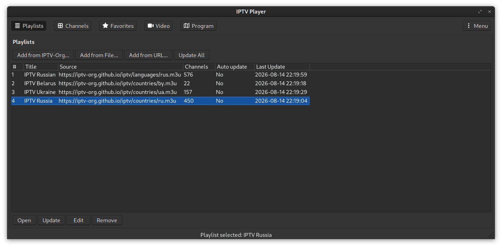
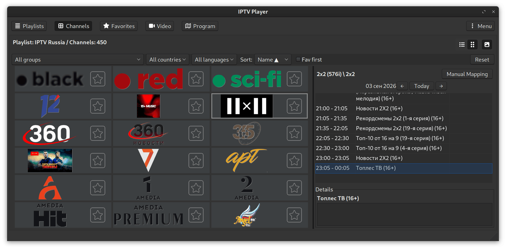
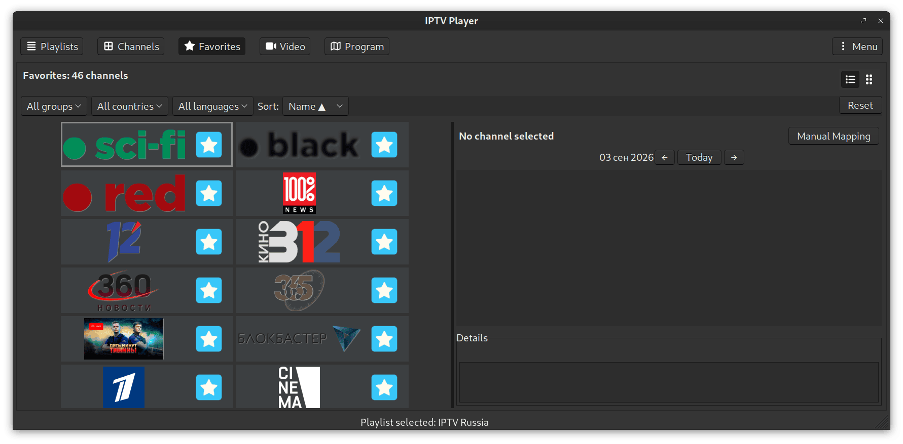
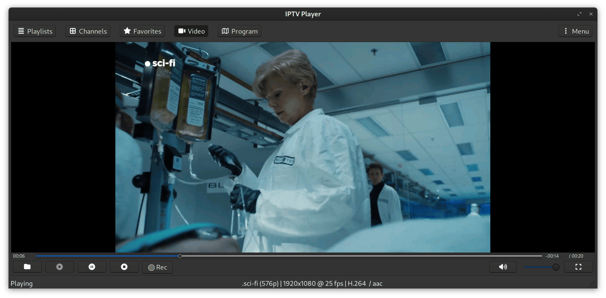
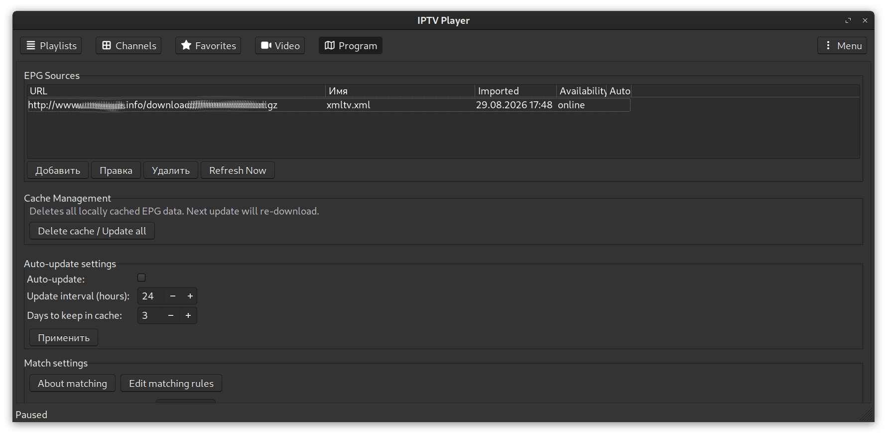

# IPTV Player

An IPTV player with M3U playlist support, favorites, channel logos, and an Electronic Program Guide (EPG).

---

## Screenshots

### Playlists

<a href="docs/screenshots/playlists.png"></a>

### Channels

<a href="docs/screenshots/channels.png"></a>

### Favorites

<a href="docs/screenshots/favorites.png"></a>

### Video Player

<a href="docs/screenshots/video.png"></a>

### EPG Program

<a href="docs/screenshots/program.png"></a>

---

## Detailed usage guide

The full user guide — playlists, channels, EPG, manual mapping, recording, IPTV-Org, export, keyboard shortcuts, data locations:

- **[Online (GitHub Pages)](https://i-jurij.github.io/iptvplayer/)**
- **[Source (docs/index.html)](docs/index.html)**
- **Offline:** bundled with the app — **Menu → About → Details**.

---

## Installation

### From GitHub Releases

Pick the artifact that matches your system:

| Artifact | Target |
| :--- | :--- |
| `iptvplayer-linux-<arch>-<version>-sharun.AppImage` | Any Linux, including old glibc, musl systems (Alpine, Void-musl), NixOS without FHS |
| `iptvplayer_<version>_<distro>_<deb-arch>.deb` | Ubuntu 24.04+, Debian 13+ |
| `iptvplayer-<version>-1.<distro>.<rpm-arch>.rpm` | Fedora 44+, Rocky 10+, RHEL 10 (with EPEL), OracleLinux R10, AlmaLinux 10, Alt p11, Rosa 13, OpenSuse Leap 16, OpenMandriva 6.0, Mageia 10 |
| `iptvplayer-<version>-1-<distro>-<arch>.pkg.tar.zst` | Arch Linux, CachyOS, EndeavourOS (current glibc) |
| `iptvplayer-<version>-1-<distro>-<arch>-compat.pkg.tar.zst` | Manjaro, Garuda, UBLinux (glibc 2.42+) |

All artifacts come with `checksums.txt` and a detached GPG signature.
See [SECURITY.md](SECURITY.md) for verification instructions.

**Supported architectures.** The scripts recognise `x86_64`, `aarch64`, `i686`
and `armv7l`/`armv8l`/`armhf` (see `detect_arch` in `scripts/common.sh`).
Only `x86_64` is exercised in CI; everything else is best-effort.
linuxdeploy-AppImage is built only for `x86_64` and `aarch64` (upstream
limitation — see `populate_appdir` in `scripts/build-appimage.sh`).

### Update your system first

It is recommended to **update and upgrade your system before installing the
application**, so that all runtime dependencies (system libraries, graphics
drivers) are current and compatible. The exact command depends on your
package manager — for example `sudo apt update && sudo apt upgrade`,
`sudo dnf upgrade --refresh`, `sudo pacman -Syu`, `sudo zypper update`,
`sudo apk upgrade`, `sudo xbps-install -Su`.

### From source

See [Building and packaging](#building-and-packaging) below.

### Codec for H.264

Most IPTV streams are H.264. On many distributions `ffmpeg` and `libmpv` from
the main repositories are deliberately built without patent-encumbered
codecs, so playback fails with a black screen or `Unable to create decoder
for h264`.

Check what's installed:

```bash
ffmpeg -hide_banner -decoders 2>/dev/null | grep -w h264
```

If the output is empty, the runtime `ffmpeg` / `libmpv` cannot decode H.264.
Enable the repository that provides a codec-full `ffmpeg` build (search your
package manager's available `ffmpeg` builds, or check the distribution's
documentation for patent / codec / multimedia repositories — e.g. RPM Fusion
on the RHEL family, Packman on openSUSE, Tainted on Mageia, restricted on
OpenMandriva), replace `ffmpeg` and `mpv` / `mpv-libs` with the versions
from it, and restart the application — a running instance keeps the old
`libmpv` mapped in memory.

Installing `openh264` alone rarely helps: it only works if the
distribution's `ffmpeg` was specifically built with `--enable-libopenh264`.

### Hardware decoding

For smooth HD playback, install VA-API drivers (`va-driver-all` on Debian/Ubuntu, `mesa-va-drivers` on Fedora/RHEL, `libva-mesa-driver` on Arch, `nvidia-vaapi-driver` for NVIDIA).

---

## Building and packaging

### 1. Building a package for your system (recommended)

Everything is driven by one entry point:

    ./scripts/make.sh --package

Passing no format flag on a TTY opens an interactive menu that lists the
formats available for the detected distribution. On a non-interactive run
(CI, `--no-menu`) the default is `--native`.

Typical flows:

    # Interactive menu — choose what to build
    ./scripts/make.sh --package

    # Native package for the current distro
    ./scripts/make.sh --package --native

    # AppImage through linuxdeploy (classic pipeline)
    ./scripts/make.sh --package --appimage

    # AppImage through quick-sharun (maximum portability:
    # old glibc, musl systems, NixOS)
    ./scripts/make.sh --package --sharun

    # Flatpak bundle
    ./scripts/make.sh --package --flatpak

    # Several formats at once
    ./scripts/make.sh --package --native --appimage --flatpak

    # Force a rebuild of the binary first
    ./scripts/make.sh --package --native --rebuild

Run `./scripts/make.sh --help` for the full list of commands and options.

**Distro-specific formats are chosen automatically.** `--native` builds
`.deb` on Debian/Ubuntu/Mint/Pop/Astra, `.rpm` on Fedora/RHEL/Rocky/Alma/
CentOS/Oracle/RedOS/ALT/ROSA/Mageia/OpenMandriva/openSUSE/SLES, `.pkg.tar.zst`
on Arch/Manjaro/EndeavourOS/CachyOS, `.apk` on Alpine, `.tbz2` on Gentoo,
`.tar.zst` on NixOS, `.txz` on Slackware, and `.xbps` on Void. The adapter
is `scripts/distros/<name>.sh`, selected by `# distro-patterns:` header
matching `$DISTRO`.

**Which variant should I pick?**

- **Native** (`.deb` / `.rpm` / `.pkg.tar.zst`) — smallest download, but
  depends on libraries already present in your distribution. Only offered
  when the script recognises your system.
- **AppImage** — self-contained, runs on any glibc ≥ 2.39 system, no
  installation required.
- **AppImage (sharun)** — uses `quick-sharun` and embeds its own dynamic
  linker; can work on old distros, musl systems (Alpine, Void-musl) and
  NixOS without FHS.

### 2. How the scripts fit together

One entry point (`make.sh`) and a set of libraries. The libraries are
sourced, not executed; you only ever run `make.sh`.

**Entry point:**

| File | Role |
| :--- | :--- |
| `scripts/make.sh` | Single entry point. Parses `--deps` / `--build` / `--package` / `--clean`, dispatches to `cmd/*.sh`, exits. |
| `scripts/bootstrap-bash.sh` | POSIX bootstrap. If `/bin/sh` is not bash, it re-execs into a system bash or downloads a static one (`bash-static-<arch>`). Honors `IPTVPLAYER_BASH_STATIC`, `IPTVPLAYER_BASH_TAG`, `IPTVPLAYER_BOOTSTRAP_DISABLE`. |

**Libraries** (sourced by `make.sh`):

| File | Role |
| :--- | :--- |
| `scripts/detect.sh` | Arch detection (`DEB_ARCH` / `RPM_ARCH` / `APPIMAGE_ARCH`), distro detection (`$DISTRO` from `/etc/os-release`, then `# distro-patterns:` matching in `distros/*.sh`), `sudo` detection, colors, logging. |
| `scripts/lib.sh` | Shared helpers: `ask`, `download`, `download_multi`, `read_versions_from_install`, `prepare_staging`, `rpm_files_block`, `detect_deb_depends`, `pack_rpm`, `pack_deb`, `deps_*`, `check_deps`, `ensure_tools`, `setup_dirs`, `sign_files`. |
| `scripts/cmd/deps.sh` | `--deps` implementation: `deps_run`, `deps_ensure_for_build`, `deps_ensure_system`, `deps_ensure_tools`, `deps_ensure_third_party` (wxWidgets + wxSQLite3 builds), `deps_cleanup_after_success`. |
| `scripts/cmd/build.sh` | `--build` implementation: `bin_run`, `bin_resolve_paths`, `bin_ensure_binary` (CMake configure/build/install/strip), `setup_log_fifo`. |
| `scripts/cmd/package.sh` | `--package` implementation: `package_run` (format selection, binary-or-build, `check_deps`, `setup_dirs`, per-format dispatch, `sign_files`), `package_show_menu`. |
| `scripts/cmd/clean.sh` | `--clean` implementation: remove `pkg-*`, `pkg-staging`, `dist/.AppDir`, `AppDir`, `compile_commands.json`; optional `third_party` (`--with-third-party`); remove packages recorded in `.iptvplayer-deps-installed`. |

**Formats** (sourced on demand by `package_run`):

| File | Role |
| :--- | :--- |
| `scripts/formats/native.sh` | `build_native` — thin dispatcher around `distro_build` from `distros/<name>.sh`. |
| `scripts/formats/appimage.sh` | `populate_appdir` + `build_appimage` — linuxdeploy + GTK plugin + `appimagetool`. |
| `scripts/formats/sharun.sh` | `build_sharun_appimage` — `quick-sharun`, DejaVu fallback, `ca-bundle.hook`, `fonts.hook`, `dbus-fallback.hook`. |
| `scripts/formats/flatpak.sh` | `build_flatpak` — `flatpak-builder` + `flatpak build-bundle` (GNOME runtime, default `org.gnome.Platform//47`). |

**Per-distro adapters** (`scripts/distros/*.sh`): one file per distribution family, selected by `# distro-patterns:` header. Each file declares `PKGMGR*`, `COM_*`, `DEPS`, `REQUIRED_TOOLS`, `PACK_FORMAT`, `RPM_*` (if applicable), and defines `distro_build()` and (optionally) `distro_setup_repos()`.

**Order of operations:**

1. `./scripts/make.sh --deps` — one-time prep. Installs system packages listed in `distros/<name>.sh` (`DEPS`), verifies required tools, then builds wxWidgets (`WX_VERSION`, default 3.3.2) and wxSQLite3 (`WXSQLITE3_VERSION`, default 5.0.1) statically into `third_party/`. Skip with `--skip-system` (only `third_party` gets built). Force rebuild of `third_party` with `--rebuild`.
2. `./scripts/make.sh --build` — CMake configure + build + install. `--type release|debug`, `--log`, `--rebuild` supported.
3. `./scripts/make.sh --package [formats]` — builds the binary if `install/bin/iptvplayer` is missing, then produces the requested formats in `dist/`. Multiple formats accepted: `--native --appimage --sharun --flatpak`. Uses `--rebuild` to wipe `build-*`, `install`, `dist`, `pkg-*`, `pkg-staging`, `AppDir` first.
4. `./scripts/make.sh --clean` — removes staging artifacts, `pkg-*` directories, and packages recorded in `.iptvplayer-deps-installed`. Does **not** touch `build-*` / `install/` / `dist/` (that is `--rebuild`'s job). Add `--with-third-party` to also remove `third_party/`.

**Order of operations, in plain terms:**

1. `scripts/setup-deps.sh` — one-time prep, produces static dependencies.
2. `scripts/build-package.sh <flags>` —
   - reads `METAINFO_NAME`, detects architecture (`DEB_ARCH`, `RPM_ARCH`, `APPIMAGE_ARCH`) and distribution (`DISTRO`);
   - checks for required tools (`dpkg-deb`, `rpmbuild`, `wget`, `tar`, `readelf`, `gpg` if signing, …);
   - if `install/bin/iptvplayer` is missing (or `--rebuild` given) — calls `build-release.sh --type release --prefix ./install --yes`;
   - reads `install/VERSION{,_FULL,_FILE}`;
   - for AppImage (linuxdeploy): populates `dist/.AppDir` via `linuxdeploy` + GTK plugin (downloaded on demand);
   - for AppImage (sharun): deploys dependencies via `quick-sharun` (downloaded on demand);
   - builds the requested artifacts into `dist/`;
   - optionally signs them (if `GPG_KEY_ID` is set) and writes `dist/checksums.txt`.
3. Result: `dist/` contains the artifacts listed at the end of the run.

Note: `build-package.sh` cleans up `pkg-staging/`, `dist/.AppDir/`,
`pkg-rpm/`, `pkg-rpm-alt/` and `pkg-rpm-rosa/` on exit. `dist/` is preserved
(unless you pass `--clean`).

### 3. Installing dependencies (manual step)

Before the first package build, run:

    ./scripts/make.sh --deps

It will:

- detect your distribution (`$DISTRO` from `/etc/os-release`, or override with
  `DISTRO=<id>-<ver>`) and source the matching `scripts/distros/<name>.sh`;
- install the packages listed in that file's `DEPS` map via `PKGMGR` (`apt-get`,
  `dnf`, `zypper`, `pacman`, `apk`, `emerge`, `xbps-install`, …); distros
  without a package manager (NixOS, Slackware) skip this step silently;
- run `distro_setup_repos` first when the adapter defines it (RHEL/Rocky EPEL,
  Oracle Linux EPEL + CRB, OpenMandriva `restricted`);
- download **wxWidgets** and build it statically with builtin libwebp;
- download **wxSQLite3** and build it statically against the local wxWidgets;
- ensure `msgfmt` (from `gettext`) is available if `po/` contains `.po` files —
  the build fails without it (see *Localization*). `gettext` is installed by
  `make.sh --deps` on every distro that uses a package manager; `msgmerge` is
  also checked and reported missing if absent, but only `msgfmt` is fatal.

Both are installed into:

    third_party/wx/install/
    third_party/wxsqlite3/install/

These paths are already configured in `CMakeLists.txt`.

The pinned versions live in `scripts/cmd/deps.sh` (`WX_VERSION`, default
`3.3.2`; `WXSQLITE3_VERSION`, default `5.0.1`). They can be overridden
without editing the script:

    WX_VERSION=3.4.0 WXSQLITE3_VERSION=5.1.0 ./scripts/make.sh --deps

Options (global — must be passed to `make.sh`):

    ./scripts/make.sh --deps                     # interactive
    ./scripts/make.sh --deps --yes               # non-interactive
    ./scripts/make.sh --deps --skip-system       # only rebuild third_party
    ./scripts/make.sh --deps --yes --rebuild     # force rebuild both

> `make.sh --deps` installs the system packages itself via your distribution's
> package manager — it only needs `sudo` (or root) and either `curl` or
> `wget`. The full package list is the `DEPS` map inside the matched
> `scripts/distros/<name>.sh`. Installed packages are recorded in
> `.iptvplayer-deps-installed` and removed automatically after a successful
> `--build` / `--package` (unless `--skip-system` was used). `--clean` also
> removes them.

### 4. Manual build (step by step)

This is the low-level path, useful if you want to understand what the scripts
do or if you need a build without packaging.

1. **Install dependencies** (see §3):

        ./scripts/setup-deps.sh

2. **Configure and build** with CMake:

        mkdir -p build && cd build
        cmake .. -DCMAKE_BUILD_TYPE=Release \
                 -DCMAKE_INSTALL_PREFIX="$PWD/../install"
        cmake --build . -j"$(nproc)"

3. **Install** the binary, icons and resources:

        cmake --build . --target install

4. **Run**:

        cd ../install/bin && ./iptvplayer

Or use the wrapper, which does all of the above in one shot:

    ./scripts/make.sh --build                          # Release, install to ./install
    ./scripts/make.sh --build --type debug             # Debug build
    ./scripts/make.sh --build --type debug --rebuild   # Clean rebuild
    ./scripts/make.sh --build --log                    # Save build log

#### `build-release.sh` options

| Option | Description |
| :----- | :---------- |
| `--rebuild` | Remove `build-<type>/`, `install/`, `pkg-staging/`, `AppDir/` before building |
| `--type release\|debug` | Build type (default: `release`) |
| `--log` | Save build log to `build_<YYYYMMDD_HHMMSS>.log` |
| `--yes`, `-y` | Non-interactive mode |
| `-h`, `--help` | Show help |

**What it does:**

1. Checks that `third_party/wx/install/lib/…` and `third_party/wxsqlite3/install/lib/…` exist; warns if not.
2. Creates `build-release/` or `build-debug/`.
3. Configures CMake with the chosen type and install prefix.
4. Builds (uses `ninja` if available, otherwise `make`).
5. Installs the executable, icons, resources, `VERSION{,_FULL,_FILE}`, metainfo, license.
6. `strip`s the binary in Release/MinSizeRel builds.
7. Copies `compile_commands.json` to the project root for IDE support.

#### `build-package.sh` options (full list)

| Option | Description |
| :----- | :---------- |
| `--native` | Native package for the detected distribution (`.deb` / `.rpm` / `.pkg.tar.zst` / `.apk` / `.tbz2` / `.tar.zst` / `.txz` / `.xbps`, whichever matches) |
| `--appimage` | AppImage through linuxdeploy + `appimagetool` |
| `--sharun` | AppImage through `quick-sharun` (maximum portability) |
| `--flatpak` | Flatpak bundle (needs `flatpak-builder`) |
| `--no-menu` | Do not show the interactive menu |
| `--rebuild` | Force rebuild of the binary (wipes `build-*` / `install` / `dist` / `pkg-*` / `pkg-staging` / `AppDir`) |
| `--yes`, `-y` | Non-interactive mode (implies `--no-menu`) |
| `-h`, `--help` | Show help |

Format flags can be combined in one invocation (`--native --appimage
--flatpak`). If no format flag is given and stdin is a TTY, `--package`
shows a menu tailored to your distribution. If stdin is **not** a TTY
(CI, `--no-menu`) the default is `--native`. Pass explicit flags to
override.

`--clean`, `--clean-only`, `--native-deb`, `--native-rpm`, `--native-arch`,
`--native-alt`, `--native-rosa`, `--native-appimage`, and `--all` no longer
exist. Use `make.sh --clean` for cleanup and `--native` (single flag) for
whichever native format the current distro provides.

Output goes to `dist/`:

    dist/
    ├── iptvplayer_<version>_<distro>_<deb-arch>.deb                    # .deb
    ├── iptvplayer-<version>-<release>.<suffix>.<rpm-arch>.rpm          # .rpm (exact parts vary, see §Installation)
    ├── iptvplayer-<version>-1-<distro>-<arch>.pkg.tar.zst              # .pkg.tar.zst
    ├── iptvplayer-<version>-r<rel>.apk                                 # .apk
    ├── iptvplayer-<version>.tbz2                                       # .tbz2
    ├── iptvplayer-<version>-<nix-system>.tar.zst                       # Nix
    ├── iptvplayer-<version>-<arch>-<build><tag>.txz                    # .txz
    ├── iptvplayer-<version>_<rev>.<arch>.xbps                          # .xbps
    ├── iptvplayer-<version>.flatpak                                    # Flatpak
    ├── iptvplayer-linux-<arch>-<version>-linuxdeploy.AppImage          # AppImage (linuxdeploy)
    ├── iptvplayer-linux-<arch>-<version>-linuxdeploy.AppImage.asc      # if signed
    ├── iptvplayer-linux-<arch>-<version>-linuxdeploy.AppImage.zsync    # if zsyncmake is present
    ├── iptvplayer-linux-<arch>-<version>-sharun.AppImage               # AppImage (quick-sharun)
    ├── iptvplayer-linux-<arch>-<version>-sharun.AppImage.asc           # if signed
    ├── checksums.txt
    └── checksums.txt.asc                                               # if signed

#### Signing (optional)

If `GPG_KEY_ID` is set in the environment when `build-package.sh` runs, it
signs:

- `.deb` via `debsigs` (falls back to a detached `.asc`);
- `.rpm` via `rpm --addsign` (falls back to a detached `.asc`);
- `*.AppImage` via a detached `.asc`;
- `checksums.txt` via a detached `checksums.txt.asc`.

`sign_files()` always writes `checksums.txt`; signing is best-effort per
file — a single failed signature is a warning, not an error. To use an
isolated GPG home (CI), set `GPG_WRAPPER_DIR` to a directory containing
`gpg` and (optionally) `pass`.

`public-key.asc` is **not** produced by the script. If you need to publish
the public key, export it manually:

    gpg --armor --export "$GPG_KEY_ID" > dist/public-key.asc

The CI release workflow does this step automatically and attaches the file
to the GitHub release.

### 5. IDE support

After any build, `compile_commands.json` is generated and copied to the
project root. This enables:

- **VSCode** with `clangd` or Microsoft C/C++ extension;
- **CLion**;
- **ccls**.

Install `clangd` (recommended):

    sudo apt install clangd-16   # Ubuntu/Debian

Then install the clangd extension in VSCode — it will use
`compile_commands.json` automatically.

### 6. Summary of common commands

| Task | Command |
| :--- | :--- |
| Install dependencies (once) | `./scripts/make.sh --deps` |
| Build package for current distro | `./scripts/make.sh --package --native` |
| Build AppImage | `./scripts/make.sh --package --appimage` |
| Build AppImage (quick-sharun) | `./scripts/make.sh --package --sharun` |
| Build Flatpak | `./scripts/make.sh --package --flatpak` |
| Build several formats at once | `./scripts/make.sh --package --native --appimage --flatpak` |
| Just build the binary | `./scripts/make.sh --build` |
| Debug build | `./scripts/make.sh --build --type debug` |
| Clean rebuild | `./scripts/make.sh --build --rebuild` |
| Clean staging artifacts | `./scripts/make.sh --clean` |
| Clean everything incl. `third_party` | `./scripts/make.sh --clean --with-third-party` |
| Run the app from `install/` | `cd install/bin && ./iptvplayer` |

---

## Localization

UI strings are translated with gettext.

- **Source strings:** extracted from C++ sources into `po/iptvplayer.pot`
  by `scripts/update-po.sh` (see below); `.pot` is not built into the binary.
- **Translations:** one `po/<lang>.po` per language.
- **Language list:** `po/LINGUAS` — whitespace-separated codes, `#` starts a
  comment. If the file is missing, every `*.po` under `po/` is compiled.
- **Build-time conversion:** CMake runs `msgfmt -o
  <build>/locale/<lang>/LC_MESSAGES/iptvplayer.mo po/<lang>.po` for each
  `po/<lang>.po`; the `locales` target depends on those files, and
  `iptvplayer` depends on `locales`. So `cmake --build` and
  `make.sh --build` produce the `.mo` files automatically.
- **Install location:** `share/locale/<lang>/LC_MESSAGES/iptvplayer.mo`
  (Linux/BSD/Windows); `iptvplayer.app/Contents/Resources/<lang>.lproj/iptvplayer.mo`
  (macOS bundle).
- **Runtime:** `Application::OnInit` calls `setlocale(LC_ALL, "")`, then
  `wxLocale::Init(wxLANGUAGE_DEFAULT)`, then `AddCatalog("iptvplayer")`
  (falling back to source strings on failure), and finally forces
  `setlocale(LC_NUMERIC, "C")` so `printf`/`strtod` use `.` — the wxLocale
  init would otherwise install a locale with `,` as decimal separator.
- **Offline About page:** `docs/index.html` is installed as
  `share/iptvplayer/about.html` and opened from **Menu → About → Details**
  (see `MainFrame::onAbout`).

**Requirements.**

- `msgfmt` (from `gettext`) is **required** at build time when `po/` contains
  `.po` files. `CMakeLists.txt` fails with a clear error otherwise. `msgfmt`
  is installed by `make.sh --deps` on every distro that uses a package
  manager.
- `msgmerge` (also `gettext`) is required to regenerate `.po` files from the
  current sources via `scripts/update-po.sh`.
- `scripts/lib.sh::check_deps` verifies both `msgfmt` and `msgmerge` when
  `po/*.po` is present, and lists them as required (non-interactive CI must
  pre-install `gettext`).

**Updating translations.**

    # 1) extract new/changed strings, merge into existing .po files
    ./scripts/update-po.sh

    # 2) edit po/<lang>.po (Poedit, Gtranslator, or a plain editor)

    # 3) rebuild — msgfmt runs automatically
    ./scripts/make.sh --build

**Adding a new language.**

1. Add the code to `po/LINGUAS` (e.g. `it`).
2. Run `./scripts/update-po.sh` — it creates `po/it.po` from `po/iptvplayer.pot`
   (or copy an existing `.po` and clear the translations).
3. Fill in the translations.
4. Rebuild.

If a language listed in `LINGUAS` has no matching `po/<lang>.po`, CMake emits
a warning and skips it; if `po/` has `.po` files but `msgfmt` is not in `PATH`,
the build stops with a `FATAL_ERROR` (not a silent skip).

## Architecture (for developers)

### Entry point

- `main.cpp` → `wxIMPLEMENT_APP(Application)`.
- The `Application` class (derives from `wxApp`) manages the application lifecycle.

### Core classes

| Class | Purpose |
| :--- | :--- |
| `Application` | Application initialization, creates `GUIManager`, loads settings and playlists. |
| `GUIManager` | Creates and manages the main window (`MainFrame`). |
| `MainFrame` | Main window with tabs: **Playlists**, **Channels**, **Favorites**, **Video**, **Program**. Handles navigation, events, and fullscreen mode. |
| `ConfigManager` | Configuration handling (JSON): saving/loading settings (`config.json`). |
| `PlaylistManager` | Manages the playlist collection, loading/updating, saving to `~/.config/iptvplayer/playlists/`. |
| `Playlist` | Stores playlist information: title, source, channels, update settings. |
| `IPTVOrgMetadataManager` | Loads metadata from the IPTV-Org repository (countries, languages, categories). |
| `AddIPTVPlaylistDialog` | Dialog for adding a playlist from IPTV-Org with filter selection. |
| `Channel` | Channel model: name, URL, `tvg-logo`, `group-title`, language, country, `tvg-id`, etc. |
| `M3UParser` | M3U file parsing, extraction of channels and attributes. |
| `IconManager` | Asynchronous loading and caching of channel logos (WebP, PNG, SVG). LRU cache. |
| `FavoritesManager` | Manages favorite channels (saved to `favorites.json`). |
| `ChannelList` / `ChannelCards` | Displays channels as a list or cards with sorting, search, and logo loading. |
| `FavoritesCards` / `FavoritesList` | Displays favorite channels in the same views. |
| `UpdateOneThread` / `UpdateAllThread` | Multi-threaded update of one or all playlists. |
| `EPGManager` | Manages EPG data: loading from URL, XMLTV parsing, caching (SQLite), channel matching by `tvg-id` and normalized names (Jaro-Winkler, tokens, suffixes). |
| `EPGParserExpat` | Streaming XMLTV parser based on Expat, for large files. |
| `EPGPanel` | Panel showing the schedule for the selected channel on the Channels and Favorites tabs (right of the list/grid). |
| `EpgSourceManagerPanel` | EPG source management panel on the **Program** tab. |
| `ManualMappingDialog` | Dialog for manual mapping of playlist channels to EPG channels. Supports search, sorting, ignoring automatic mappings. |
| `EPGDatabase` | SQLite storage for channels, programs, and per-playlist mappings (WAL, memory-mapped I/O, thread-safe). |
| `EPGRefreshQueue` | Sequential queue for EPG source refreshes (one at a time, `Clear()` keeps the current one running). |
| `EPGParserExpat` | Streaming XMLTV parser based on Expat. |
| `VideoPanel` | Video playback panel with controls (play/pause/stop, volume, fullscreen, recording). |
| `PlayerController` | Manages the player backend (mpv). |
| `MpvBackend` | Player interface implementation via libmpv, including video recording support. |
| `MpvGLCanvas` | `wxGLCanvas` with mpv `render_gl` FBO rendering; OpenGL 3.3 Core. |
| `AddXtreamPlaylistDialog` | Adds a playlist from an Xtream Codes server (username/password, bare host or full URL). |
| `xtream::ProbeAsync` | Background probe of a bare Xtream server to discover the correct `get.php` endpoint. |

### Dialogs

- `AddPlaylistFileDialog` — add a playlist from a file.
- `AddPlaylistUrlDialog` — add by URL.
- `EditPlaylistDialog` — editing with M3U export.
- `SettingsDialog` — settings: logos, auto-update, EPG sources, update interval, caching, recording methods.
- `AddIPTVPlaylistDialog` — add a playlist from IPTV-Org (filter by country, language, category).
- `ManualMappingDialog` — manual channel-to-EPG mapping.
- `AddEpgSourceDialog` — add/edit an EPG source (URL or local file).
- `AddXtreamPlaylistDialog` — add a playlist from an Xtream Codes server.

### Technologies

- **C++17 minimum, C++20 by default.** `CMakeLists.txt` falls back to
  `CMAKE_CXX_STANDARD=17` when the variable is unset (the minimum the code
  uses; kept for old toolchains such as GCC 7.5 on Astra 2.12);
  `make.sh --build` always passes `-DCMAKE_CXX_STANDARD=20` via
  `bin_ensure_binary()`.
- **gettext (`msgfmt`, `msgmerge`)** — translation compilation and
  `.po` maintenance (see *Localization*).
- **wxWidgets** (static build; version pinned in `scripts/cmd/deps.sh`).
- **libmpv** (system static `libmpv.a`, GL renderer).
- **OpenGL 3.3 Core** — for `MpvGLCanvas`; EGL/Wayland on Linux.
- **libcurl** — URL downloads.
- **libwebp** — WebP image handling.
- **rapidjson** — JSON handling (`FavoritesManager`, `EPGDatabase`, IPTV-Org metadata).
- **Expat** — streaming XML parser (EPG).
- **SQLite3** (via wxSQLite3) — storage for EPG data and mappings.
- **zlib** — gzip decompression for XMLTV.
- **CMake** — build system.

---

## Environment variables

### `IPTVPLAYER_CA_BUNDLE`

Path to a PEM file with trusted CA certificates. When set, applied to
every libcurl handle via `CURLOPT_CAINFO` (see `ApplyCurlCaBundle` in
`src/Utils.cpp`).

**Why it exists.** Bundled `libcurl` inside `*-sharun.AppImage` is built
with a hardcoded CA path from the build host. If that path does not exist
on the target system — for example, Arch's
`/etc/ssl/certs/ca-certificates.crt` on Fedora, where the bundle lives at
`/etc/pki/ca-trust/extracted/pem/tls-ca-bundle.pem` — HTTPS requests fail
with `Problem with the SSL CA cert`.

**Platform support:**

| Platform | Effect |
| :--- | :--- |
| **Linux** — `*-sharun.AppImage` | Set automatically by `bin/ca-bundle.hook`. Required for HTTPS to work on systems where the hardcoded path is missing. |
| **Linux** — native `.deb` / `.rpm` / `.pkg.tar.zst` | Optional. System libcurl already knows the right path. Set only to override. |
| **FreeBSD / OpenBSD / NetBSD** | Optional. System libcurl usually uses `/etc/ssl/cert.pem`. Set if your libcurl is built with a different path. |
| **macOS** | No effect. libcurl uses SecureTransport → Keychain. |
| **Windows** | No effect. libcurl uses Schannel → system certificate store. |

**Manual override** (any platform where the variable has effect):

    IPTVPLAYER_CA_BUNDLE=/path/to/ca-bundle.pem ./iptvplayer-linux-x86_64-*.AppImage

For the sharun variant, the value can also be persisted in the runtime's
`.env` file placed next to the AppImage:

    echo 'IPTVPLAYER_CA_BUNDLE=/path/to/ca-bundle.pem' >> iptvplayer-linux-x86_64-*-sharun.AppImage.env

**How it is set automatically (Linux, sharun only).** Inside
`*-sharun.AppImage` the hook `bin/ca-bundle.hook` picks the first
existing file from a list of well-known Linux locations and exports the
variable before the application starts. On other platforms the hook does
not exist and is not needed.

### Runtime (sharun / Anylinux-sharun)

The `*-sharun.AppImage` runtime is `quick-sharun` on top of
`Anylinux-sharun`. It reads its own environment variables for debugging,
overriding library paths and tuning GPU behaviour. Full list is in the
upstream documentation:

- <https://github.com/VHSgunzo/sharun> (base runtime)
- <https://github.com/pkgforge-dev/Anylinux-sharun> (fork used in this project)

One variable worth knowing: `SHARUN_MESA_PATH` — points to an external
Mesa installation (e.g. `SHARUN_MESA_PATH=/usr`) to use the system GL
stack instead of the bundled one. Useful on systems where the bundled
Mesa misbehaves (virgl in VMs, certain NVIDIA setups), but may fail if
the system Mesa is too old for OpenGL 3.3 Core.

### Build-time (optional)

- `GPG_KEY_ID` — GPG key to sign artifacts (see *Signing* above).
- `GPG_WRAPPER_DIR` — directory containing `gpg` (and optionally `pass`)
  to use an isolated GPG home (typical for CI).
- `DISTRO` — override distro detection (`debian-12`, `fedora-44`, …).
- `DEB_ARCH` / `RPM_ARCH` / `APPIMAGE_ARCH` — cross-packaging arch overrides.
- `CC` / `CXX` / `CFLAGS` / `CXXFLAGS` — cross-compilation toolchain and flags.
- `CMAKE_CXX_STANDARD` — C++ standard (default `20`).
- `WX_VERSION` — wxWidgets version (default `3.3.2`).
- `WXSQLITE3_VERSION` — wxSQLite3 version (default `5.0.1`).
- `CMAKE_CXX_STANDARD` — C++ standard passed to CMake. `make.sh --build`
  defaults to `20`; `CMakeLists.txt` falls back to `17` when unset (for
  old toolchains).
- `GETTEXT_MSGFMT` — path to `msgfmt`, found automatically by CMake. Set
  it only to override; the build still requires `msgfmt` to exist when
  `po/*.po` is present.
- `VOID_PACKAGES_DIR` — Void Linux `void-packages` clone (default `~/void-packages`).
- `NIX_SYSTEM` — Nix system string (default from `uname -m`).
- `FLATPAK_RUNTIME`, `FLATPAK_RUNTIME_VERSION` — Flatpak runtime (default `org.gnome.Platform` / `47`).
- `QUICK_SHARUN_REF` — `quick-sharun` git ref (default `main`).
- `IPTVPLAYER_BASH_STATIC` — path to a static bash to use.
- `IPTVPLAYER_BASH_TAG` — tag for the static bash release (default `latest`).
- `IPTVPLAYER_BOOTSTRAP_DISABLE` — do not download a static `bash`;
  require a system one in `PATH`.

`SETUP_DEPS_SKIP_SYSTEM` no longer exists; use the `--skip-system` flag
to `make.sh --deps` instead.

The full list of build-time variables is documented in the headers of
`scripts/*.sh`.

---

## Notes

- The scripts are designed for Linux; isset scripts for Windows.
- After a successful build, `install/` contains a ready-to-run tree; after a
  successful package build, `dist/` contains the artifacts.
